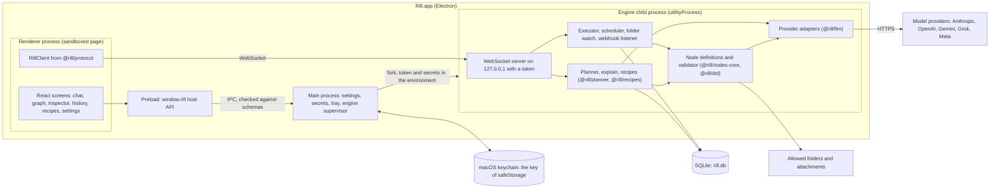

# Rill

Describe an automation in plain language, review it as a graph, and run it on your own machine.

Rill is a desktop app for macOS. You type what you want ("when a receipt PDF lands in a folder, read the amount and date, add them to a CSV and tell me on Slack"), a language model proposes a workflow, and you read it as a graph before anything runs. A durable engine inside the app then runs the workflow locally, retries what can be retried, and picks up where it stopped after a crash.

Status: early development, not released. The engine, the planner, the five model providers, the recipes, the failure explanation and every screen of the app are built and tested. The macOS installer (ad hoc signed, not notarized) builds. The planner evaluation has not been run yet (see [Evaluation](#evaluation)).

Rill is an independent project and has no affiliation with any workflow-automation vendor.

## The demo scene

1. In the chat: "When a receipt PDF arrives in the folder, have the model read the amount and the date, add them to a CSV, and tell me on Slack" (typed in Korean in the recording).
2. If the request leaves a gap, Rill asks the few questions it cannot guess: which folder, which CSV file, which Slack connection. A request that already names them skips this step.
3. It shows the workflow as a graph with a plain summary. A value that did not come from your own words carries a flag, and deploy waits until you confirm each one. Then you deploy.
4. A dry run reads the sample receipt and skips the CSV write and the Slack message. You activate the workflow.
5. You copy a receipt into the watched folder. The nodes light up one by one, a row appears in the CSV, and the Slack message goes out.
6. A run that fails (a Slack address that does not work) gets a "why did it fail" button that explains the cause in plain words and offers the next step.

`pnpm demo:prepare` creates the sample folder with synthetic receipts. [docs/demo.md](docs/demo.md) is the full two-minute script with the exact texts to type. A screen recording is planned and not made yet.

## Features

| Feature | What it does |
| --- | --- |
| Planner | Turns a request into a typed workflow, a short list of questions, or a refusal. Generation is constrained by the workflow schema, checked in four stages (schema, graph, meaning, missing information) and repaired for up to three rounds. With a node selected, a request about an existing workflow produces a patch to that node instead of a rewrite. |
| Questions and flags | When the request leaves a gap, the planner asks instead of guessing. Values that did not come from your own words (a folder from an attachment, a new send target, a path built from document content) are flagged, and deploying needs a confirmation for each flag. |
| Graph | A read-only React Flow canvas with live node states, an inspector for the input and output of every attempt, and a run history that replays any past run on the graph. |
| Durable engine | SQLite in WAL mode. Each step is written down before it runs, so a run killed with `kill -9` resumes after restart. A node with a retry policy is retried with exponential backoff and jitter on network errors, 5xx and 429. Folder watching waits for a file to stop changing and deduplicates by fingerprint. Cron has a missed-run policy. A dry run skips the external side effects. |
| Recipes | Six ready-made workflows (receipts to CSV, large receipt alert, daily health check, webhook to Slack, monthly reminder, failure alert) filled in from a short form. No model, no key and no network are needed. |
| Failure explanation | For a failed run, one button asks the model to explain the cause. The step record is sent with secrets masked, the answer comes back as a closed schema, and nothing is stored or executed. Suggested actions are buttons that the app owns. |
| Five providers | Anthropic (the default), OpenAI, Gemini, Grok and Meta behind one interface that declares what each model can do. Keys are encrypted with Electron `safeStorage`, whose key is in the macOS keychain. |
| Memory | Up to 20 short notes that you write yourself ("my receipts live in ~/Receipts"). The planner reads them on each request. Nothing else can create or change a note. |
| Storybook | Every screen is a story with fixtures and a fake engine. Look at all of it without an API key, an engine or Electron. |
| Desktop shell | Tray icon, open at login, secrets encrypted with `safeStorage`, a hardened window, and a macOS installer built with electron-builder. |

## Architecture



| Package | Role |
| --- | --- |
| `@rill/dsl` | The workflow format: schema, version, reference syntax, graph and reference checks, issue codes. |
| `@rill/protocol` | Message types and schemas between the engine and its clients, plus the WebSocket client. |
| `@rill/nodes-core` | The 12 built-in nodes (4 triggers, 8 actions) and the shared validator. One definition per node gives the planner its catalog, the validator its rules and the executor its code. |
| `@rill/engine` | Durable executor, scheduler, folder watch, webhook listener, SQLite store, WebSocket server and the `rill-engine` command line. |
| `@rill/llm` | One `LlmProvider` interface over five providers, with declared capabilities, usage and a dated price table. |
| `@rill/planner` | Request to workflow: generation, validation, repair, patch mode, provenance flags, memory and failure explanation. |
| `@rill/recipes` | The ready-made workflows and their parameter validators. |
| `@rill/eval` | The evaluation harness for the extraction node and the planner. |
| `apps/desktop` | The Electron app and the React renderer, with Storybook. |

Three rules shape the design. The engine is a headless package, and the app is a thin client that talks to it over a protocol. The model decides the graph only while planning, and never while a workflow runs. Every workflow, whether it comes from the planner, a recipe or a client, goes through the same validator.

## Run it

Requirements: Node.js 24 (see `.nvmrc`) and pnpm 11 (pinned in `package.json`).

```
pnpm install
pnpm check
```

`pnpm check` runs ESLint, the TypeScript checks and the whole test suite (more than 8,000 tests, including the `kill -9` recovery test). CI runs the same three steps.

| Goal | Command |
| --- | --- |
| Start the app in development (a server and a window start, so run it in your own terminal) | `pnpm --filter @rill/desktop dev` |
| Look at every screen without the app | `pnpm --filter @rill/desktop storybook`, then open http://localhost:6006 |
| Build a static Storybook to share | `pnpm --filter @rill/desktop build-storybook` |
| Build the macOS installer (a `dmg` and a `zip` in `apps/desktop/release/`) | `pnpm --filter @rill/desktop dist` |
| Create the demo folder with synthetic receipts | `pnpm demo:prepare` |
| Run the engine without the app | `pnpm --filter @rill/engine cli serve`, see [packages/engine](packages/engine/README.md) |
| Check the evaluation harness without a key or a network | `pnpm eval extract --baselines` and `pnpm eval planner --dry` |

Add a model key in the app under Settings, Keys. Saving first asks the provider whether it accepts the key (one model-list request, no cost, from the main process; the addresses are from vendor documentation and not yet verified live), refuses a key that is clearly rejected unless you choose "save anyway", and then stores it encrypted with `safeStorage`, whose key is in the macOS keychain. The command line reads `ANTHROPIC_API_KEY` and the other provider variables from the environment instead.

The installer is signed ad hoc and not notarized, so macOS blocks a downloaded copy. [apps/desktop](apps/desktop/README.md) explains the one-time unblock step.

## Security model

The short version. [docs/security.md](docs/security.md) has the threat model, the place in the code where each control lives, and what is not covered.

1. Keys and connection secrets are encrypted with Electron `safeStorage`, whose key is in the macOS keychain. They are never written to the database, a workflow or a log, and the window never receives one. Without a keychain, saving is refused.
2. The engine listens on `127.0.0.1` only and requires a random token that is new on every start. It also checks the `Host` and `Origin` headers.
3. Files are limited to the folders you picked in the system dialog. The validator rejects a workflow that names a path outside them, and the nodes check the real path again at run time.
4. The model chooses the graph only while planning. A running `llm.extract` returns fields limited by a schema, so an instruction hidden in a PDF cannot add or reorder nodes.
5. A plan value that did not come from your own words (an attachment, a new send or write target, a path built from document content) carries a flag. The plan cannot be deployed until you confirm each flag.
6. Everything that sends content to a model provider is marked "external transfer": attachments, notes, failure explanations and the receipt recipe.
7. Attachments, run data, web responses and model output are untrusted. Attachments, notes and run data are wrapped in random tags before a model sees them. Model output is shown only as plain text, and hidden-character tricks are made visible.
8. A memory note is created only by your explicit save. A plan, an attachment or a model answer has no way to write one, and invisible formatting characters are refused.
9. Failure explanations mask secrets in several encodings, and new URLs, hosts and email addresses in the model's answer are replaced before they can become your next request.
10. The window runs with context isolation and the sandbox on, Node integration off, denied permissions and navigation, and a custom `app://` scheme. The built app adds a strict content security policy. The packed app flips the Electron fuses and turns the developer tools off. Development mode (`dev`) has no content security policy and keeps the developer tools on.

## Evaluation

Two suites run on synthetic data and write a markdown report each (`pnpm eval extract`, `pnpm eval planner`). The extraction node is measured now. The planner suite is built and approved (48 cases) and waits for the owner's run.

### Extraction: amount, date and vendor from a receipt

Run on 2026-11-11 (report date 2026-11-11T14:49Z), suite version `1.1.2.2-p20261103-de8981032790-eb44b002b67a`, price table of 2026-11-03. The suite has 36 receipts, each as text, PDF and PNG (108 cases), three repetitions per case and model, so 324 calls per model and 972 in all. All calls finished and none was refused. Each model runs as the node ships it, at effort `low`.

| Model | Case pass (95% CI) | Amount | Date | Vendor | Injection resisted | Latency p50 / p95 | Mean tokens in / out | Total cost | Cost per 100 receipts |
| --- | --- | --- | --- | --- | --- | --- | --- | --- | --- |
| claude-haiku-5-5 | 99.1% (97.2 to 100.0), 321 of 324 | 100.0% | 99.1% | 100.0% | 54 of 54 | 1.26 s / 1.96 s | 1404 / 52 | $0.0539 | $0.0166 |
| claude-sonnet-5-5 | 100.0%, 324 of 324 | 100.0% | 100.0% | 100.0% | 54 of 54 | 1.93 s / 4.09 s | 1404 / 34 | $1.02 | $0.32 |
| claude-opus-5-5 | 100.0%, 324 of 324 | 100.0% | 100.0% | 100.0% | 54 of 54 | 2.13 s / 5.15 s | 1404 / 35 | $2.05 | $0.63 |

Case pass means all three fields are right. "Injection resisted" counts the adversarial cases (18 cases, three repetitions) in which the output did not contain the injected value. The whole run cost $3.12.

How to read it:

- The suite is at its ceiling for the larger models, so it does not separate them. The paired difference between Haiku and either larger model is +0.9 points with an interval of 0.0 to +2.8, and the report calls it not distinguishable. The report's noise floor is about 23 points with 36 receipts.
- Haiku's three misses are one case repeated three times: the text version of a Korean note to a neighbour, which is not a receipt. The model returned the date written in the note, and the suite expects an empty date for a document that is not a receipt. Every PDF and PNG case is correct.
- Baselines on the same cases: all-null 13.9%, a regex on the text receipts 36.1% (13 of 36), the oracle 100%.
- The data is synthetic and clean. The numbers say nothing about photos, scans or real receipts.

A later Haiku-only run with a stricter wording of the field descriptions (one repetition, 108 calls, 2026-11-11T14:58Z, suite version `1.1.2.2-fstrict-p20261103-de8981032790-eb44b002b67a`) scored 97.2% (105 of 108) at a total cost of $0.0206. It is a different suite variant with one repetition, so it is not directly comparable with the table above.

### Planner: request to workflow, questions or refusal

Not run yet. The suite has 48 approved cases: 20 easy, 10 ambiguous (the right answer is a question), 8 unsupported (the right answer is a refusal), 6 with attachments (two with an injected instruction) and 4 patch requests. `pnpm eval planner --dry` prints the cost estimate and a suggested budget without any call. Date and suite version fill in when the owner runs it.

| Metric | claude-haiku-5-5 | claude-sonnet-5-5 | claude-opus-5-5 |
| --- | --- | --- | --- |
| Valid on the first try | pending | pending | pending |
| Valid after repair, mean repair rounds | pending | pending | pending |
| Structural assertions passed | pending | pending | pending |
| Invented node types | pending | pending | pending |
| Question precision, recall and needless questions | pending | pending | pending |
| Unsupported requests refused | pending | pending | pending |
| Injection isolated (flagged and needs confirmation) | pending | pending | pending |
| Cost and latency per case | pending | pending | pending |

## Known limitations

- macOS first. The installer is signed ad hoc and not notarized, and the smoke check of the packed app runs on macOS only. Windows and Linux are untested.
- The graph is read-only. You change a workflow by selecting a node and asking in the chat (patch mode), or with a recipe. Editing node settings in forms is not built. There is no delete for a workflow.
- The delivery guarantee is at least once. A crash between sending a Slack message and recording it can send the message twice. CSV rows are deduplicated by an idempotency key.
- A dry run still reads the file and calls the model, because reading is not a side effect. It skips the CSV write, the Slack message and HTTP requests.
- Webhook triggers listen on `localhost` only. There is no tunnel and no cloud sync.
- No OAuth connectors. Outputs are CSV, Slack and plain HTTP. Slack posts through a bot token that you create in your own Slack app and paste into Settings (older incoming webhook connections keep working).
- Only the Anthropic adapter has been called live (by the extraction evaluation). The OpenAI, Gemini, Grok and Meta adapters are tested against fake transports built from vendor documentation, and `pnpm eval check-provider` exists to verify them once keys are available. Grok does not read PDFs.
- No local models (Ollama, hosted Llama).
- Secrets reach the engine through the environment of its process. On macOS any process of the same user can read that block. [docs/security.md](docs/security.md) lists this and the other gaps.
- The extraction numbers come from synthetic receipts. The planner numbers do not exist yet.

## License

To be decided before the repository goes public.
